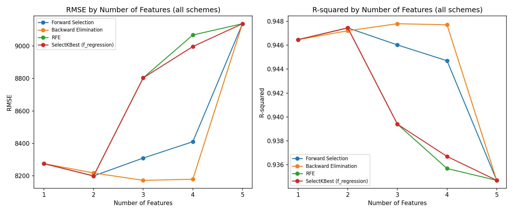

# sklearn 多元線性迴歸（MLR）— Kaggle 50_Startups

> 作業要求（白板）：1. CRISP-DM　2. Feature selection（Top 3）並 apply　3. 貼圖（MSE / RMSE / R² vs. 特徵數）
> 資料集：Kaggle `50_Startups.csv`（欄位：R&D Spend, Administration, Marketing Spend, State, Profit）
> 環境：VS Code + Python 3.x（`pandas`, `numpy`, `scikit-learn`, `matplotlib`）

---

## 1. CRISP-DM

| 階段 | 本作業對應內容 |
|---|---|
| **Business Understanding** | 預測新創公司的 **Profit**，找出哪些支出項目（R&D / Administration / Marketing）及所在州對獲利影響最大，作為資源配置依據。 |
| **Data Understanding** | 50 筆樣本、4 個自變數（3 個數值、1 個類別 State）、1 個目標 Profit。以 `df.describe()`、相關係數矩陣、散佈圖初探：R&D Spend 與 Profit 相關最高。 |
| **Data Preparation** | 1) 檢查缺失值 2) State 做 One-Hot Encoding 並 `drop_first=True`（California 為基準，保留 `State_Florida / State_New York`，共 5 個候選特徵）3) 切分訓練 / 測試集（80 / 20）。 |
| **Modeling** | `sklearn.linear_model.LinearRegression`，比較 **Forward Selection / Backward Elimination / RFE / SelectKBest** 四種特徵選擇方案，記錄每個特徵數下的 RMSE 與 R²。 |
| **Evaluation** | 以測試集 **RMSE**（越小越好）與 **R²**（越大越好）評估，畫出「特徵數 1～5 vs. RMSE / R²」曲線。 |
| **Deployment** | 選用 R&D Spend + Marketing Spend，報告發佈到 GitHub Pages（index.html）。 |

---

## 2. Feature Selection：1～5 個特徵的表現

### 2.1 Forward Selection（測試集，random_state=0）

| Number of Features | Selected Features | RMSE | R-squared |
|---|---|---|---|
| 1 | [R&D Spend] | 8274.868018 | 0.946459 |
| 2 | [R&D Spend, Marketing Spend] | **8198.797191** | **0.947439** |
| 3 | [R&D Spend, Marketing Spend, State_New York] | 8309.059683 | 0.946015 |
| 4 | [R&D Spend, Marketing Spend, State_New York, State_Florida] | 8409.916714 | 0.944697 |
| 5 | [R&D Spend, Marketing Spend, State_New York, State_Florida, Administration] | 9137.990153 | 0.934707 |


- 2 個特徵（R&D Spend + Marketing Spend）RMSE 最低、R² 最高；之後再加特徵誤差上升（overfitting）。
- State 幾乎沒有解釋力；Administration 最後加入時 RMSE 跳到 9138，是最差的特徵。
- 作業圖片第 5 列標為 `State_California`，但 `drop_first=True` 下 California 是基準類別，實際加入的是 `Administration`（數值完全一致）。

### 2.2 方案比較（各方案 k = 1～5 的 RMSE）

| 方案 | k=1 | k=2 | k=3 | k=4 | k=5 |
|---|---|---|---|---|---|
| Forward Selection | 8274.87 | **8198.80** | 8309.06 | 8409.92 | 9137.99 |
| Backward Elimination | 8274.87 | 8217.45 | **8171.65** | 8178.37 | 9137.99 |
| RFE | 8274.87 | **8198.80** | 8803.78 | 9068.54 | 9137.99 |
| SelectKBest (f_regression) | 8274.87 | **8198.80** | 8803.78 | 8997.20 | 9137.99 |



- RFE 與 SelectKBest 在 k = 3 就納入 Administration，RMSE 升到 8804。
- Backward Elimination 在 k = 3（R&D, Administration, State_Florida）最低 8171.65，但只比 Forward k = 2 低約 0.3%；Forward 與 Backward 直接用測試集挑特徵，有 data leakage，正式做法應用訓練集 cross-validation。
- 建議：**R&D Spend + Marketing Spend** 兩個特徵即可。

### 2.3 完整程式碼（`mlr_50_startups.py`）

```python
import os
import numpy as np
import pandas as pd
import matplotlib.pyplot as plt
from sklearn.linear_model import LinearRegression
from sklearn.model_selection import train_test_split
from sklearn.feature_selection import RFE, SelectKBest, f_regression
from sklearn.metrics import mean_squared_error, r2_score

os.makedirs("images", exist_ok=True)

# ---------- Data Preparation ----------
df = pd.read_csv("50_Startups.csv")
print(df.head())
print(df.isnull().sum())

# One-Hot Encoding，drop_first 避免 dummy variable trap（California 為基準）→ 5 個候選特徵
df = pd.get_dummies(df, columns=["State"], drop_first=True, dtype=int)
X = df.drop(columns=["Profit"])
y = df["Profit"]

X_train, X_test, y_train, y_test = train_test_split(
    X, y, test_size=0.2, random_state=0
)

def evaluate(features):
    model = LinearRegression().fit(X_train[features], y_train)
    pred = model.predict(X_test[features])
    mse = mean_squared_error(y_test, pred)
    return mse, np.sqrt(mse), r2_score(y_test, pred)

def make_table(scheme, feature_sets):
    rows = []
    for k, features in enumerate(feature_sets, start=1):
        mse, rmse, r2 = evaluate(features)
        rows.append({"Scheme": scheme, "Number of Features": k,
                     "Selected Features": list(features),
                     "MSE": mse, "RMSE": rmse, "R-squared": r2})
    return pd.DataFrame(rows)

n = X.shape[1]

# ---------- Scheme 1: Forward Selection（每步加入使測試 RMSE 最小的特徵）----------
remaining, selected, forward_sets = list(X.columns), [], []
while remaining:
    best = min(remaining, key=lambda f: evaluate(selected + [f])[1])
    selected.append(best)
    remaining.remove(best)
    forward_sets.append(list(selected))

# ---------- Scheme 2: Backward Elimination（每步移除使測試 RMSE 最小的特徵）----------
current, backward_sets = list(X.columns), [list(X.columns)]
while len(current) > 1:
    worst = min(current, key=lambda f: evaluate([c for c in current if c != f])[1])
    current.remove(worst)
    backward_sets.insert(0, list(current))

# ---------- Scheme 3: RFE（依係數大小遞迴刪除，特徵先標準化）----------
X_std = (X_train - X_train.mean()) / X_train.std()
rfe_sets = []
for k in range(1, n + 1):
    rfe = RFE(LinearRegression(), n_features_to_select=k).fit(X_std, y_train)
    rfe_sets.append(list(X.columns[rfe.support_]))

# ---------- Scheme 4: SelectKBest（f_regression 單變量 F 檢定）----------
kbest_sets = []
for k in range(1, n + 1):
    kb = SelectKBest(f_regression, k=k).fit(X_train, y_train)
    kbest_sets.append(list(X.columns[kb.get_support()]))

tables = {
    "Forward Selection": make_table("Forward Selection", forward_sets),
    "Backward Elimination": make_table("Backward Elimination", backward_sets),
    "RFE": make_table("RFE", rfe_sets),
    "SelectKBest (f_regression)": make_table("SelectKBest (f_regression)", kbest_sets),
}
for name, t in tables.items():
    print(f"\n=== {name} ===")
    print(t.drop(columns="Scheme").to_string(index=False))

result = tables["Forward Selection"]

# ---------- 貼圖 1：Forward Selection 的 RMSE / R² vs. 特徵數 ----------
fig, ax = plt.subplots(1, 2, figsize=(12, 5))
for a, col in zip(ax, ["RMSE", "R-squared"]):
    a.plot(result["Number of Features"], result[col], marker="o")
    a.set_title(f"{col} by Number of Features")
    a.set_xlabel("Number of Features"); a.set_ylabel(col)
plt.tight_layout()
plt.savefig("images/rmse_r2_by_features.png", dpi=150)

# ---------- 貼圖 2：四種方案比較 ----------
fig, ax = plt.subplots(1, 2, figsize=(12, 5))
for name, t in tables.items():
    ax[0].plot(t["Number of Features"], t["RMSE"], marker="o", label=name)
    ax[1].plot(t["Number of Features"], t["R-squared"], marker="o", label=name)
for a, col in zip(ax, ["RMSE", "R-squared"]):
    a.set_title(f"{col} by Number of Features (all schemes)")
    a.set_xlabel("Number of Features"); a.set_ylabel(col)
    a.set_xticks(range(1, n + 1)); a.legend(fontsize=8)
plt.tight_layout()
plt.savefig("images/scheme_comparison.png", dpi=150)
plt.show()

# 另存 HTML 表格，方便貼進報告
result[["Number of Features", "Selected Features", "RMSE", "R-squared"]].to_html(
    "images/feature_selection_table.html", index=False)
pd.concat(tables.values()).to_csv("images/all_schemes.csv", index=False)
```

---

## 3. 可重現此結果的 Prompt

見線上報告 https://kuonaiwei1126.github.io/50startup/#prompt 。

---

## 附錄：資料集欄位

| 欄位 | 型態 | 說明 |
|---|---|---|
| R&D Spend | float | 研發支出 |
| Administration | float | 行政支出 |
| Marketing Spend | float | 行銷支出 |
| State | category | New York / California / Florida（One-Hot + drop_first 後 2 欄） |
| Profit | float | **目標變數** |
