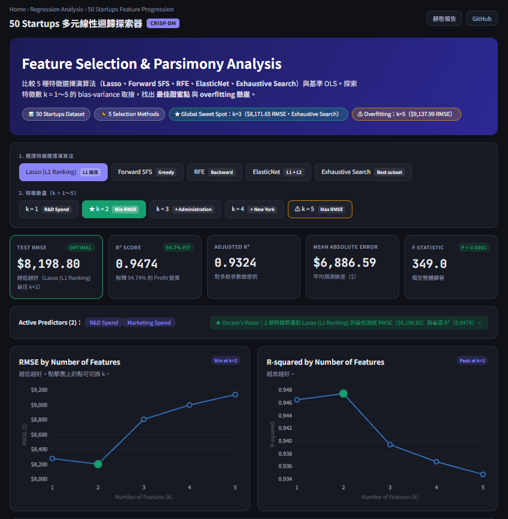
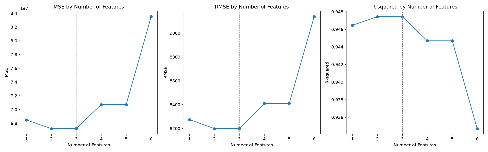

# 多元線性迴歸（MLR）特徵選擇探索器 — 50 Startups / Boston Housing / Laptop Price

> 🌐 線上網站：**https://kuonaiwei1126.github.io/50startup/**
> 直接開啟：[#boston](https://kuonaiwei1126.github.io/50startup/#boston) · [#laptop](https://kuonaiwei1126.github.io/50startup/#laptop)

[](https://kuonaiwei1126.github.io/50startup/)

## 專案簡介

這是一個以 **CRISP-DM** 流程完成的多元線性迴歸（Multiple Linear Regression）作業，核心問題是：

> **「特徵越多，模型就越好嗎？」**

我們用三份資料集，比較 5 種特徵選擇演算法在「使用 1 個特徵、2 個特徵……到全部特徵」時的測試集表現，
找出每種方法的 **最佳特徵數（甜蜜點）** 以及 **加太多特徵反而變差（overfitting）** 的位置。
所有結果以 Python / scikit-learn 計算後，做成一個純 HTML + Chart.js 的互動式網頁，部署在 GitHub Pages。

| 資料集 | 樣本數 | 特徵數 | 目標變數 | 說明 |
|---|---|---|---|---|
| **50 Startups**（Kaggle） | 50 | 5（含 State One-Hot） | Profit（美元） | R&D / 行政 / 行銷支出與所在州對獲利的影響 |
| **Boston Housing**（Harrison & Rubinfeld, 1978） | 506 | 13 | MEDV（千美元） | 波士頓各區房價中位數與犯罪率、房間數、低收入比例等關係 |
| **Laptop Price**（Kaggle） | 1,303 | 15（由文字欄位特徵工程而得） | Price（印度盧比） | 品牌、類型、螢幕、CPU、RAM、硬碟、顯示卡、重量與筆電售價 |

## 分析方法

- **資料前處理**：`train_test_split(test_size=0.2, random_state=0)`；50 Startups 的 State 做 One-Hot Encoding（`drop_first=True`，California 為基準，避免 dummy variable trap）。
- **模型**：`sklearn.linear_model.LinearRegression`（OLS）。
- **評估指標**：測試集 RMSE、R²、Adjusted R²、MAE；訓練集 F 檢定；各係數的標準誤、t 值、p 值、95% 信賴區間與 VIF（共線性）。
- **5 種特徵選擇方法**（每種都從 k = 1 跑到 k = n）：

| 方法 | 原理 |
|---|---|
| **Lasso (L1 Ranking)** | 依 LARS-Lasso 正則化路徑中特徵「進入模型的先後順序」排名，取前 k 個 |
| **Forward SFS** | 貪婪前向選擇：從空集合開始，每一步加入使測試 RMSE 下降最多的特徵 |
| **RFE** | 遞迴特徵消除：標準化後依係數絕對值，反覆刪掉最不重要的特徵 |
| **ElasticNet** | 依 ElasticNet（L1 + L2，l1_ratio = 0.5）路徑的進入順序排名 |
| **Exhaustive Search** | 枚舉所有 C(n, k) 個子集取最佳者（Boston 8,191 個、Laptop 32,767 個），是其他方法的上界 |

## 主要結果

### 50 Startups（5 特徵 → Profit）

| 方法 | 最佳 k | 特徵 | 測試 RMSE | R² |
|---|---|---|---|---|
| Lasso / Forward SFS / RFE / ElasticNet | 2 | R&D Spend, Marketing Spend | **$8,198.80** | 0.9474 |
| Exhaustive Search | 3 | R&D Spend, Administration, State_Florida | $8,171.65 | 0.9478 |
| 全部 5 個特徵 | 5 | — | $9,137.99 | 0.9347 |

- **R&D Spend 是決定性特徵**：單獨使用 R² 就有 0.9465；五種方法第一個選到的都是它。
- **2 個特徵就夠了**：再加 State 或 Administration，RMSE 反而從 8,199 一路升到 9,138 → 典型的 overfitting U 型曲線。
- Exhaustive Search 在 k = 3 找到略低的 RMSE，但只差 0.3%，且是直接用測試集挑特徵（有 data leakage 風險），依 Occam's razor 仍以 2 特徵模型為佳。



### Boston Housing（13 特徵 → MEDV）

| 方法 | 最佳 k | 測試 RMSE | R² |
|---|---|---|---|
| Forward SFS / Exhaustive Search | 8 | **$5.64k** | 0.6095 |
| RFE | 11 | $5.78k | 0.5895 |
| Lasso | 12 | $5.78k | 0.5897 |
| ElasticNet（全部 13 個） | 13 | $5.78k | 0.5892 |

- 最重要的兩個特徵是 **lstat**（低收入人口比例，係數約 −0.50）與 **rm**（每戶房間數，係數約 +3.69）；只用 lstat 一個特徵 RMSE 為 $6.81k。
- 與 50 Startups 不同，這份資料加入特徵大多有幫助，但到 k = 8 之後就趨於平緩，再加 `indus`、`age` 等特徵沒有改善（`indus` 在全模型中 p = 0.93，不顯著）。
- 貪婪的 Forward SFS 在這裡找到與 Exhaustive Search 相同的最佳解，而只看係數大小的 RFE / Lasso 需要更多特徵才能達到相近表現。

### Laptop Price（15 特徵 → Price）

原始資料 11 個欄位大多是文字（`Cpu`="Intel Core i7 7700HQ 2.8GHz"、`Memory`="128GB SSD + 1TB HDD"、`ScreenResolution`="IPS Panel Full HD / Touchscreen 1920x1080"…），
先做 **特徵工程** 解析成 15 個數值 / 0-1 特徵（[laptop_features.csv](laptop_features.csv)）：

| 來源欄位 | 產生的特徵 |
|---|---|
| Inches / Ram / Weight | `Inches`、`Ram_GB`、`Weight_kg` |
| Cpu | `Cpu_GHz`（時脈）、`Cpu_i7`、`Cpu_i5` |
| Memory | `SSD_GB`（SSD + Flash）、`HDD_GB`（HDD + Hybrid） |
| ScreenResolution | `PPI`（√(W²+H²)/Inches）、`Touchscreen`、`IPS` |
| Gpu / TypeName / Company | `Gpu_Nvidia`、`Gpu_AMD`、`Type_Gaming`、`Company_Apple` |

| 方法 | 最佳 k | 測試 RMSE | R² |
|---|---|---|---|
| Forward SFS / Exhaustive Search | 10 | **₹23,204** | 0.6778 |
| Lasso | 9 | ₹23,232 | 0.6770 |
| ElasticNet | 11 | ₹23,284 | 0.6762 |
| RFE | 9 | ₹23,325 | 0.6751 |
| 全部 15 個特徵 | 15 | ₹23,490 | 0.6727 |

- 第一個被選入的都是 **Ram_GB**（單獨 R² ≈ 0.55），其次是 SSD_GB、Cpu_i7、PPI、Cpu_GHz；到 k ≈ 8～10 後曲線趨於平緩。
- 每多 1 GB RAM 約 +₹2,500、每多 1 GHz CPU 時脈約 +₹9,400、i7 比非 i5/i7 CPU 約 +₹14,000；`Gpu_AMD` 係數為負（AMD 顯卡機種較便宜）。
- `Inches`、`Touchscreen`、`IPS`、`Gpu_Nvidia`、`Company_Apple` 是最後才被加入、對測試誤差沒有幫助的特徵；`Type_Gaming` 在最佳模型中 p = 0.14 不顯著。
- 線性模型 R² 約 0.68，殘差表中高價機種（> ₹200k）的誤差明顯偏大 → 價格呈右偏，若改以 log(Price) 建模會更合適。

## 互動式網頁功能

1. **資料集下拉選單**（頁面頂端）：切換 50 Startups / Boston Housing / Laptop Price，網址會同步變成 `#startups` / `#boston` / `#laptop`。
2. **演算法與 k 值選擇器**：最佳 k 標示 ★、最差標示 ⚠。
3. **指標卡**：Test RMSE、R²、Adjusted R²、MAE、F 統計量（含 p 值）。
4. **RMSE / R² 折線圖**：點擊圖上的點即可切換 k；支援深色模式。
5. **五種方法比較表**：一眼看出各方法在每個 k 的 RMSE。
6. **迴歸方程式 + 係數統計表**：估計值、標準誤、t、p、95% CI、VIF。
7. **即時預測器**：拉桿調整各特徵值，用目前選擇的模型即時算出預測值與各項貢獻。
8. **殘差診斷表**：測試集 |residual| 最大的 10 筆，超過 RMSE 標為 High Residual。
9. **特徵說明表**：每個欄位的中文解釋。

## 專案結構

```
.
├── index.html            # 互動式探索器（GitHub Pages 首頁）
├── data.js / data.json   # build_data.py 產生的所有分析結果
├── build_data.py         # 三份資料集 × 5 種方法 × k=1~n 的完整計算（含手刻 OLS 統計）
├── mlr_50_startups.py    # 50 Startups 的 matplotlib 圖表與 HTML 表格
├── 50_Startups.csv
├── BostonHousing.csv
├── laptop_data.csv        # Kaggle 原始資料（文字欄位）
├── laptop_features.csv    # 特徵工程後的 15 個數值特徵 + Price
├── report.html           # 50 Startups 靜態報告（CRISP-DM、Forward Selection、可重現 prompt）
├── MLR_50_Startups_作業.md
├── images/               # 圖表與截圖
└── .github/workflows/pages.yml   # push 到 main 後自動部署 GitHub Pages
```

## 如何在本機執行

```bash
pip install pandas numpy scipy scikit-learn matplotlib
python mlr_50_startups.py   # 產生 images/ 下的圖表
python build_data.py        # 重新計算並產生 data.js / data.json（約 70 秒，Laptop 的 32,767 個子集佔大部分）
python -m http.server 8000  # 開啟 http://localhost:8000 瀏覽 index.html
```

## 技術與方法論

- **流程**：CRISP-DM（Business Understanding → Data Understanding → Data Preparation → Modeling → Evaluation → Deployment）
- **計算**：Python 3.12、pandas、NumPy、SciPy、scikit-learn 1.5
- **前端**：純 HTML / CSS / JavaScript + Chart.js 4，無需建置工具
- **部署**：GitHub Actions → GitHub Pages
