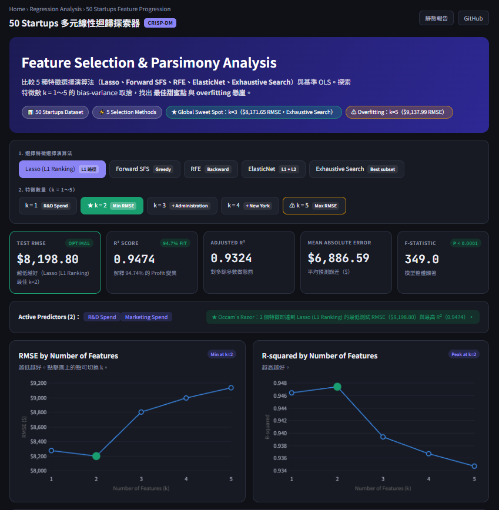

# 50_Startups 多元線性迴歸（MLR）

互動式探索器（5 種特徵選擇方法 × k = 1～5、係數統計、VIF、即時預測、殘差診斷）：`index.html`。
靜態報告：`report.html` / [MLR_50_Startups_作業.md](MLR_50_Startups_作業.md)。

```bash
pip install pandas numpy scikit-learn matplotlib
python mlr_50_startups.py   # 產生圖表
python build_data.py        # 產生 index.html 用的 data.js / data.json
```

[](https://kuonaiwei1126.github.io/50startup/)


線上報告（GitHub Pages）：https://kuonaiwei1126.github.io/50startup/
